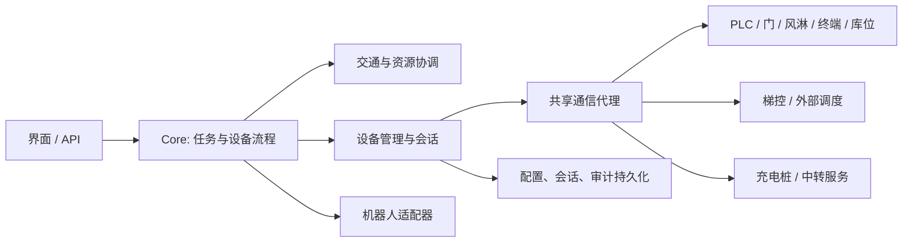

# 设备模块接入与调度设计（方案草案）

本方案依据 `E:\仙工资料\调度系统对接设备模块资料` 中七份 Markdown 及电梯附件制定；设备地址、协议版本、现场安全逻辑均需现场确认。本文件是设计，不代表功能已经实现或真机验证通过。以下“必须”是拟定的接入条件，具体安全边界由现场设备和安全负责人确认。

## 1. 结论与现状

建议在 Nayantra Core 增加独立的基础设施设备管理、协议驱动、设备会话和资源协调层，把门、风淋室、电梯、库位、产线终端、充电桩统一接入任务与交通流程。机器人接口和设备接口分开：机器人负责运动和自身动作，设备驱动负责设备命令和反馈，Core 负责流程、互斥和恢复。先选一套现场设备完成仿真和联调，再逐协议扩展；不能按品牌名称推断设备已兼容。

当前代码证据：

- `nayantra/core/legacy_rmf.py` 的门和电梯兼容接口明确返回不存在；`docs/architecture.md` 中提到的可选 Open-RMF 基础设施工具不等于 Core 已接入这些设备。
- `models.py` 的 `TaskStep` 只有 `go_to` 和 `action`；`fleet.py` 的执行器在两者间分支。未实现原生动作时 `_act` 会以定时等待兜底，所以产线握手、充电成功等需要真实反馈的步骤不得沿用这种兜底。
- `routing.py` 的图、`traffic.py` 的计划和占用按 `map_id` 管理，`tasks.py` 将任务解析到单地图；电梯需要跨地图拓扑、跨楼层共享资源和机器人切图/重定位能力，不能仅增加电梯 API。
- `RobotAdapter` 提供路径、停止及原生动作，尚无设备协议、切地图/楼层确认的通用契约。现有充电有目标点及机器人动作/电池监控，不能证明具备 SRC800 中转协议或真实充电桩状态。
- `store.py` 当前持久化地图、车队、机器人、任务等文档和事件；设备配置、会话、设备占用及断电恢复尚需设计和迁移。

## 2. 资料逐项理解

| 资料 | 关键要求和范围 | 需确认或限制 |
| --- | --- | --- |
| 门 | Modbus TCP 单地址/多地址开关及状态，支持电平与脉冲；HTTP `/controlDoor`、`/doorStateList`；提前开门、空闲关门、状态合并读取。HTTP 状态有开到位、关到位、运动、离线和故障。 | 仅开到位信号不能推导可靠关到位；HTTP 示例 `doorNameList` 是数组内逗号分隔字符串，需现场确认实际格式和时间戳语义；关门需确认机器人完全离开和防夹逻辑。 |
| 电梯 | 区域到楼层映射、提前呼梯、共享互斥、可选关门；旧 `proxy` 连续七寄存器，新 `proxyNew` 独立状态值，`proxy3` 增加关门，`proxyNewExtend` 增加 AGV 模式握手；倍加信的读楼层值和呼梯命令分别映射。 | 每台梯控协议、呼梯/选层、开门保持、占用检测和状态编码需确认。旧 `proxy` 页面标注不要使用。开门超时、其他楼层先关门等为可配置策略而非所有梯控都支持。 |
| 风淋门 | 外→内：门1开到位、入室、门1关到位、风淋完成、门2开到位、出室、门2关到位；反向示例不风淋，反向需按现场工艺确认。涉及四条有向路线、室内点、双门和风淋故障。 | 资料明确“设备组”配置未完成不能使用；以完整旧模型信号流程为依据。两门互锁和风淋安全必须由设备/PLC负责，调度只配合。 |
| 终端 | `RobotStatus` 为调度向设备输出，`TerminalStatus` 为设备向调度反馈；Modbus 客户端 proxy 和多寄存器 extendedProxy，仿真类型；文中 slave 服务端标为待支持。 | 寄存器所有权、值、动作及应答/复位时序均因工位而异；提供 slave 配置表不代表其已可用。 |
| 库位 | PLC 光电、RoboView 或 RDS 状态；库位名称、库区、状态地址和 holder 地址；多系统共享时 holder 表示 Core 是否可操作。 | 状态、holder 的值域和原子抢占机制未给出；外部状态不等于取得占用权。原文对功能码 1/3、2/4 的模拟工具表述与标准 Modbus 表不一致，不能直接照搬。 |
| 通信代理 | Modbus TCP 可共享连接，支持绑定客户端 IP；HTTP 代理；电梯还涉及 UDP、定制 HTTP。资料显示 Modbus 默认端口 502、slave ID、超时；HTTP 示例 base URL 限制为 origin。 | PLC 连接数/速率/地址空间上限和超时需测量；120 秒示例不是推荐的安全超时。 |
| SRC800 | 网络隔离时 RDSCore 在机器人与充电桩间中转；机器人侧品牌 `RDSCore_src`，设备名称必须匹配；RDSCore 离线时机器人不能独立自动充电。 | 未提供中转协议、认证及桩控制报文；不能据此实现兼容中转，需要厂商提供协议或 SDK，并确认机器人端是否允许替代服务。 |

附件补充：金博 PDF 描述端口 53000 的自定义报文/JSON 和命令响应、到层自动开门；旺龙 PDF 描述 TCP Server 61000、自定义帧和状态主动上报；倍加信 DOCX 描述 UDP、默认梯控端口 3964/3965 及内外呼命令；MCTC PDF 描述 Modbus RTU/485 转换板及 AGV 协议；定制 DOCX 描述 04 读取状态和 06 控制，部分字段为位/字节；木牛 XLS 包含互斥区申请/释放、电梯呼叫/门/状态和门接口。Markdown 中金博、旺龙关联 ModbusTCP 代理以及上世场景使用 ModbusTCP，与附件传输描述不能直接等同：可能存在网关或版本差异，必须确认实际链路、转换及适用协议。附件为多家设备的不同协议，不能混合寄存器或命令。资料中的外链（RoboView、RDS 配置、项目 issue）未随资料提供；梯控调试工具压缩包含程序，仅盘点未执行，图示和附件可能还有补充信息，需在对应设备选型后逐项核对。

## 3. 接入前需要准备

### 3.1 每台设备的交付表

1. 设备唯一 ID、名称、位置、厂商、型号、固件、控制器和协议版本、产权及联调联系人；设备与 PLC/网关/调度之间的拓扑图。
2. IP、端口、网段、路由、防火墙、是否需绑定本机 IP、网关、连接数限制、超时、心跳、轮询周期、响应速度及中断恢复规则；HTTP/UDP 的认证、授权、加密与网络隔离要求。密钥存入部署密钥管理，不写地图或日志。
3. 经设备厂签字的接口控制文件：协议、角色、地址基准（显示地址与 PDU 零基地址）、Unit ID、功能码、数据宽度、字节/字顺序、位含义、读写权限、状态值、有效时间、命令触发方式、脉冲宽度/复位值、确认、重复发送与丢包语义、并发限制、超时和错误码。多地址写入是否原子及中间态安全行为必须明确。
4. 现场安全联锁、人工操作权、消防/急停/断电处理、故障复位、允许远程控制范围、人员进入规则及责任人；机器人安全功能和设备防夹/门锁/风淋互锁应独立于普通调度网络。
5. 测试环境、PLC/设备模拟器、协议样例、可控故障注入、联调窗口、验收指标和回退方案；约定操作日志、数据保留和故障处置。

### 3.2 各设备补充资料

- **门**：门及方向、等待点/通过线/完全离开区域、宽度和机器人轮廓、开/关到位独立信号、防夹、占用检测、开门保持、自动关闭条件、现场是否允许提前开门。
- **电梯**：电梯 ID、轿厢尺寸/承重、可通行机器人、各楼层地图和楼层读值/指令映射、停靠门侧、前置点/轿内点/出口点、门及轿厢占用信号、呼梯/选层/保持门/取消能力、外部调度互斥、机器人进出确认、乘梯时定位与切图/重定位机制、断电救援方案。
- **风淋**：两门开关到位、风淋启动/运行/完成/故障、方向对应四条路径和室内驻停点、是否双向均需风淋、完成信号复位及可靠的新周期识别、PLC 互锁和人工介入方式。
- **终端与库位**：工位作业时序图及信号真值表，机器人到位、请求、准备、运行、完成、故障、清零、超时和重试规则；货物有无、库位 owner 值域及与 WMS/RDS/RoboView 的权威来源、可原子占用的接口、更新延迟和人工操作规则。
- **充电**：桩型号/接口协议、SRC800 中转规范及机器人识别配置支持、对接姿态、占用检测、充电开始/结束/故障反馈、断连和中断策略、电池阈值及退出条件。
- **机器人**：各车型真实适配器和协议、轨迹执行与到点反馈、暂停/停止效果、轮廓载荷、原生取放/输送/充电动作、楼层切换接口与可信定位质量。当前内置模拟器不能代表这些真实能力。

## 4. 目标架构和数据模型

建议新增 `nayantra/core/devices/`：`models.py`、`registry.py`、`manager.py`、`sessions.py`、`resources.py`、`drivers/` 和 `transports/`；由 `runtime.py` 管理生命周期。可用 SQLite 增加集合/表及版本化迁移，不能覆盖既有地图和任务。资源获取/释放及关键流程转移采用事务；单 Core 为第一期前提，多实例部署需数据库租约、单写者及 fencing，不能依靠进程内锁。

核心实体：

- `TransportProfile`：id、协议、端点引用、Unit ID、本机绑定、连接及读写超时、限速、轮询、凭据引用、版本。按端点及约束共享连接并串行化请求，响应按 transaction ID 匹配；限流、重连、退避、断路器和读写队列防止 PLC 过载。UDP/HTTP/厂商 TCP 由对应实现处理。
- `Device`：id、类型、驱动版本、transport、能力、启停/维护状态、配置版本和设施绑定；`Signal` 包含读写功能码、地址、数据类型、匹配值、极性、触发/脉冲与复位等。配置校验读写功能码和地址空间、设备支持能力和冲突，批量读仅在同端点、Unit ID、功能码、有效连续范围及设备限制内进行，不能跨未允许地址。
- `DeviceState`：标准化状态及原始值、来源、采集/设备时间、质量 `good/stale/offline/invalid`、故障；超时或状态矛盾标记未知，不能推断为关闭、空闲或成功。时钟不同步时以本地接收时间判断新鲜度。
- `FacilityBinding`：设备与地图、双向有向 lane、等待点、进入/离开确认区域、互斥资源绑定；电梯另设物理楼层、各地图入口/轿厢/出口、门侧及切图信息；风淋另设室内点和四段有向路径。校验配置引用、方向和可达性。
- `DeviceSession`：session ID、设备/机器人/任务、方向、目标、状态、命令序号、确认和截止时间、配置版本、所持资源、最后已确认物理状态、恢复状态及审计记录。`ResourceLease` 记录物理资源、持有人、状态、版本和现场确认，覆盖跨地图轿厢/风淋室/门及必要的进出口区域。

设备状态和命令响应分别记录：发送成功、PLC 写入成功或 HTTP 返回成功都不等于物理动作完成；必须等待新鲜的对应到位/完成反馈。幂等键只保证 Core 内部去重，不能保证第三方设备恰好执行一次；未知写入结果先读状态并按协议和现场流程对账，不盲目重复脉冲或启动指令。

## 5. 调度与流程设计

### 5.1 交通与资源

在地图 lane 上绑定设施通行规则，路径规划可估算等待成本，并在设备离线/维护时排除不可用路径；设备状态变化时对未来路径重新规划。执行阶段在发放设备入口 lane 之前获取设备会话与所需交通资源，确保入口、内部和出口衔接。提前开门/呼梯只能在获得相应调度权且现场许可后进行；未收到新鲜的到位状态，机器人必须停在设备外的安全等待点。

资源以稳定 ID 全局管理，轿厢、风淋室及必要前置/出口区域跨地图共享，按固定顺序或原子批量申请避免死锁；等待有优先级、公平队列及饥饿保护。避免持有设备等待被其他车长期占用的出口，进入前检查出口可用；但对故障中的在途机器人保留物理占用，不能仅因租约到期释放。恢复/人工清除需要设备和机器人现场状态确认。交通现有按地图计划、重规划、暂停和释放逻辑都要扩展，并验证失败时不会提前放行其他机器人。

### 5.2 普通门

`等待资源 → 开门请求 → 等待开到位 → 许可进入 → 确认车尾离开门区 → 按策略关门 → 等待关到位（若有）→ 释放`。开门超时、通信丢失、异常信号和人员操作进入等待/故障；已进门时按现场方案安全停住并保留资源。支持 level 和 edge，脉冲复位任务独立处理、记录复位失败；实际是否可周期重复发送以设备协议为准。HTTP 示例中 `state=2` 为完全打开，不能把状态 1/3 的移动中视为可通行。没有独立关到位反馈时状态标记未知，不能用“开信号不满足”替代已关到位。

### 5.3 电梯与跨楼层

先实现楼层级拓扑：任务含起终地图，规划器将路线拆为本楼层路径、跨楼层电梯边、目标楼层路径；候选电梯按能力、可达性、等待时间筛选。机器人适配器必须提供地图切换、切换结果及定位可信度反馈，明确轿内运动与跨层定位策略；未具备则拒绝跨楼层任务。

会话：`申请轿厢及入口/出口资源 → 按需进入 AGV 模式 → 呼到起始楼层 → 确认起始楼层、开门到位及可进入 → 进入并确认整个机器人在轿内 → 按协议关门/选目标楼层 → 确认目标楼层、到位及门开 → 机器人切图与定位确认 → 出轿并确认车尾离开 → 关闭/释放及退出 AGV 模式`。具体切图发生在轿内还是出轿前，由机器人和梯控联调确定，但在目标地图导航前必须确认定位有效。切图失败、电梯停层错误、关门/到层超时、通信丢失、断电或取消，进入人工处置状态并保留轿厢占用；禁止自动声称任务完成或释放。电梯停靠/门状态缺失时不能以命令应答替代。

### 5.4 风淋室

按资料的正反方向建立独立状态机，风淋需求作为方向/工艺策略配置。持有整室和两门入口/出口资源，确认另一门关到位后请求开门；机器人进入并完全驻停后确认首门关到位，再启动风淋，识别本次完成后开另一门，确认车尾离开及关门到位才释放。工艺状态需防止上一次残留完成信号直接完成新周期。任何双门状态矛盾、故障、掉线或超时均停在安全等待状态并保留占用；PLC 保持硬件互锁，异常复位由现场授权人员依流程操作。

### 5.5 终端与库位

终端由版本化、受约束的握手模板编排：`占用工位 → 机器人到位 → 确认设备就绪 → 写请求 → 等待本次应答 → 启动机器人/设备动作 → 确认双方完成及货物状态 → 按约定复位 → 释放`。各步骤包含超时、可重复性、补偿及人工恢复规则；不同工位提供具体状态值及流程，不能把一个通用模板当作所有产线协议。持续旧应答必须先清零或按协议用序号/边沿识别。

库位状态和业务占用分开：传感器表达物理有货/无货/未知，业务占用表达谁有权操作。分配只选择新鲜且符合任务条件的库位；多人或多系统并发需 WMS/PLC 提供原子申请、确认、释放或单一权威协调服务，否则无法保证互斥。任务失败/重启时根据实际物料及权威占用对账，不自动把传感器状态当锁。

### 5.6 充电

调度选择与机器人兼容的可用桩，预约桩和进出路径；机器人对接，充电动作及设备/电池反馈共同确认启动，再根据电量/策略结束，确认停止和车体离开后释放。桩离线或中转断开保持未知、通知操作员。SRC800 中转适配需取得协议后再实现，并与机器人厂验证识别文件及行为；仅配置 IP 和名称不足以开发互通。

## 6. 故障、恢复与操作接口

- 暂停、取消、急停分别定义：立即停止新的设备动作并请求机器人安全停车；不能假定机器人已退出设备区域，也不自动撤销电梯/风淋的物理占用。后续动作按设备安全规程和操作者决定。
- 在发送不可逆或非幂等命令前持久化意图，记录发送、应答及物理确认。重启先冻结受影响区域，重连后读取设备、机器人位置和会话，再由可证明安全的规则恢复；无法确认时转人工恢复。明确通信、传感器质量及配置版本冲突，不自动重发危险指令。
- API 建议：`/api/v1/devices` 和 `/transports` 管理配置，`/devices/{id}/state`、`/sessions`、`/resources` 查看状态，会话诊断及事件通过现有 WebSocket 发布。手动控制应有权限、审计、互斥和确认，并拒绝绕过占用或安全条件；单独设计维护模式及恢复接口。设备配置修改需版本校验，活动会话使用固定版本。
- UI 展示设备在线/未知/故障、物理状态及采集时间、会话阶段、等待原因、资源持有人、超时和恢复指引；地图标注入口、范围、方向、楼层和设备。日志带 task/robot/device/session/command ID，不记录密钥。

## 7. 实施顺序与验收

1. **协议澄清与设计冻结**：收集第 3 节清单，选定首台门、PLC 和一台机器人，确认安全回路及边界；形成信号清单、时序和测试用例。
2. **基础设施层**：设备注册、模拟驱动、共享 Modbus TCP 连接及只读轮询、状态质量、事件和资源持久化；先只读观测，再受控写入。实现连接限制、异常、断线、重复信号及启动恢复测试。
3. **普通门闭环**：地图绑定、门资源、开到位及完整离开确认、故障保持；仿真双车对向、提前开门、状态过期、超时、断线、暂停取消和重启，再经 PLC 模拟器与现场验收。
4. **终端与库位**：完成一个真实工位握手模板和权威占用接口；验证重复应答、物料异常、多系统抢占、写结果未知及恢复。随后实现风淋完整状态机和双门互锁配合。
5. **跨楼层电梯**：先多地图拓扑、机器人切图能力及模拟电梯，再选定一种现场梯控实现专用驱动，进行梯控仿真与现场受控联调；其余品牌逐个按协议开发。验证对向竞争、轿内掉线、错误楼层、门故障、切图失败与断电恢复。
6. **充电桩**：先验证机器人原生充电、桩占用与反馈；取得 SRC800 中转协议之后再开发和验收。

每阶段完成单元测试、协议模拟器测试、端到端仿真、故障注入和现场联合验收。核心通过条件：未知/过期状态不得放行；互斥区域不同时授权冲突机器人；任务成功由真实动作/设备反馈确认；重启或断连不丢失可能的物理占用；日志可追溯。真实设备、人员安全和厂商协议兼容需现场验证，软件仿真不能替代。
